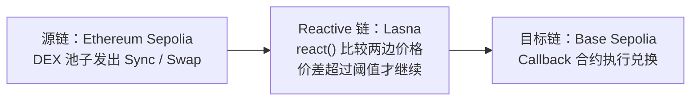

# 用例拆解卡：跨链 DEX 价差自动再平衡

日期：2026-11-16  
学员：Lavie（GitHub: Chic7777）  
类型：自己的想法（结合本营学习目标：理解事件 → react() → 跨链回调）

## 这个想法是什么

我想做的是更好的套利：同一类资产在两条链的 DEX 上经常会出现短暂价差。传统做法是自己 24 小时开着机器人盯盘。这个用例想用 Reactive 来做同一件事：源链价格一变，就自动判断是否值得动，值得的话在目标链自动完成兑换。

这是学习阶段的设计，还没有真正部署到主网，也不会动用真实资金。

## 1. 监听哪条链、哪个合约的什么事件？

- 源链：Ethereum Sepolia（本营练习用测试网；主网思路相同，只是换成 Ethereum 上的 DEX）
- 监听对象：某个 DEX 交易对合约（Uniswap V2 风格的 Pair）
- 事件：`Sync(uint112 reserve0, uint112 reserve1)` 或 `Swap(...)`
  - `Sync` 会在池子储备变化后发出，可以从储备算出即时价格
  - 同时，在 Reactive 合约里也可以再订阅目标链池子的 `Sync`，把那边的最新价格记下来，方便两边对比

## 2. 满足什么条件时触发？

不是每一次 Swap 都行动。只有同时满足这些条件才请求回调：

- 已经拿到源链和目标链两边的最新价格
- 价差扣除手续费、滑点和预估 gas 之后，仍然大于我设定的最低利润阈值（例如 1%）
- 回调合约里还有足够的目标链 ETH 支付 gas，Reactive 合约也没有欠费（debt 必须为 0）

如果不满足，`react()` 里直接 `return`，避免无效回调还照样花钱。

## 3. 在哪条链做什么动作？

- 目标链：Base Sepolia（出块更快，适合练习；主网可换成 Base 或其他 DEX 所在链）
- 动作：由 Callback 合约去目标链上的对应 DEX 执行兑换，把价格偏低的一侧买进来，或把偏高的一侧卖出去，完成一次再平衡
- 路径：源链事件 → Lasna 上的 Reactive 合约 `react()` 判断 → `SYSTEM.requestCallbackV_1_0` → 目标链 Callback 合约执行交易

## 4. 如果不用 Reactive，你要怎么做？Reactive 让它简单在哪里，代价是什么？

不用 Reactive，我就得自己写一个机器人，租一台一直开着的服务器，同时盯两条链的区块和事件，算出价差后再用私钥发交易。机器人一宕机、网络一断，就会漏掉机会；私钥还要放在这台机器上，风险更高。

Reactive 让它变简单的地方：

- 不用自己保活一台盯盘机器，订阅之后由网络在事件出现时自动调用 `react()`
- 跨链回调是协议能力，不必自己再搭一套跨链消息或中继
- 触发逻辑写在合约里，规则公开、可验证

代价：

- 每次 `react()` 都要花 lREACT / REACT，回调还要在目标链花 ETH；失败也会收费；一旦出现欠费（debt > 0），合约会静默停止收事件
- 订阅只能做链上事件的等值匹配，不好直接接入中心化交易所价格、自己的离线模型或私有交易流
- 套利里很多优势来自速度、资金部署和复杂策略，Reactive 更适合「规则明确、必须 24 小时在线」的自动执行，不能单靠它就保证赚到钱
- 真正的跨链套利还要考虑两边是否有库存、桥接延迟和滑点，这个用例先按「目标链上已有可交易资金」来设计

## 简图：源链 → Reactive → 目标链



```
Ethereum Sepolia          Lasna (Reactive)           Base Sepolia
DEX 池子                  Reactive 合约              Callback 合约
────────                  ─────────────              ────────────
Sync / Swap 事件  ──►   react()：算价差      ──►   调用 DEX 执行兑换
                        超过阈值才                 用目标链 ETH 付 gas
                        requestCallback
```

## 学习备注

我目前是 Web3 和金融小白，这个拆解卡是为了先把「事件 → react() → 回调」套到我真正关心的套利场景上。后面如果继续做，会先在测试网用很小的仓位验证触发条件，再考虑要不要写成黑客松项目。
